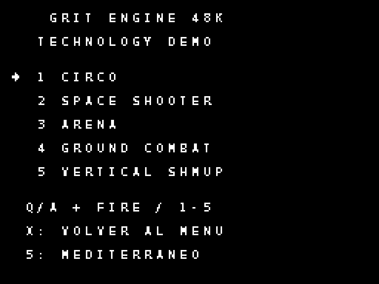

# GRIT ENGINE ZX — V1.1 en preparación

**Tony C. Ware · 2026 · ZX Spectrum 48K · Z80**

Primera versión oficial del motor de desarrollo por perfiles. Reúne las técnicas desarrolladas en Circo Dimensional, Halcones Estelares, Grit Claymore, ERROR 2026 y Neptuno Ataca. Los perfiles seleccionan sus propios mapas de memoria y renderizadores; no se concatenan indiscriminadamente.



## Technology Demo V1.0

[Descargar TAP](demo/technology_demo/GRIT_ENGINE_TECH_DEMO_V1.0.tap) · [Manual técnico PDF](docs/GRIT_ENGINE_48K_MANUAL_TECNICO_V1.0.pdf)

Cinco pruebas en una sola carga: 1 Circo, 2 Space Shooter, 3 Arena, 4 Ground Combat, 5 Vertical Shmup. QAOP + SPACE y Kempston autodetectable. Selección mediante 1–5 o Q/A y disparo. X vuelve al menú; en la quinta demo también se vuelve al agotar las vidas o derrotar al jefe. Solo contiene la primera fase del Mediterráneo, sin título ni pantalla de carga del juego. No necesita rebobinado.

## Desarrollo

- `core/`: formatos comunes y extracciones Z80 con procedencia.
- `profiles/`: perfil vertical completo y banco de rendimiento.
- `demo/technology_demo/`: demostración autónoma, fuentes, ensamblado, símbolos, capturas y pruebas.
- `provenance/`: commits fijados, huellas y registros técnicos.
- `reference/`: binario de referencia de Neptuno para regresión, no integrado como campaña en la demo.
- `docs/`: manual técnico.

```sh
python3 -m pip install -r requirements.txt
python3 grit.py verify
python3 demo/technology_demo/build.py
python3 demo/technology_demo/test_demo.py
python3 grit.py build vertical_neptuno
python3 grit.py test vertical_neptuno
```

El TAP de la demo V1.0 conserva byte a byte el último ejecutable entregado. SHA-256: `1e8ba440885f76da162da0518e5120b1b16f13d4600b289c1494d19305cdfd31`.

## Alcance de V1.0

Versión oficial del banco de desarrollo por perfiles y su demostración. Las primeras cuatro pruebas usan el núcleo compacto común; la quinta usa el motor vertical original adaptado. No implica que todos los módulos históricos puedan enlazarse entre sí ni certifica 50 FPS de vídeo o hardware físico. Para reconstruir íntegramente los cuatro juegos originales restantes, importar los árboles fijados (`python3 grit.py import all`, requiere Git y conexión), siguiendo el manual. Sus builds cruzados y una ABI Z80 universal quedan fuera del alcance de esta versión. Los repositorios de los juegos no se modifican.

## Licencias

Código e infraestructura MIT, conservando las atribuciones originales de `LICENSE`. Los gráficos y contenidos de los juegos se conservan como referencia; no se amplían sus permisos de reutilización. Consulta las licencias artísticas de los proyectos originales. No confundir el banco de fuentes con una licencia de los recursos gráficos.

## Sexto perfil: horizontal_escoria (V1.1-dev)

La rama de integración incorpora el motor horizontal de ESCORIA SIDERAL V1.0, con commit fijado, compositor en RAM por bandas sucias, sprites dispersos con diccionario, scroll de suelo a 2 px, multicarga, director de oleadas, jefes por parches y beeper con presupuesto mínimo. Conserva los cinco perfiles y la Technology Demo V1.0 sin cambios.

```sh
python3 grit.py import Escoria-Sideral
python3 grit.py build horizontal_escoria
python3 grit.py test horizontal_escoria
python3 grit.py demo6
```

La sexta prueba se genera como TAP autónomo de una sola fase, con su propio menú y salida X. No se ha enlazado aún con el menú de las otras cinco pruebas. Validación nominal Z80; pendiente prueba en Fuse. [Notas de integración](docs/GRIT_ENGINE_ZX_V1.1_ESCORIA.md).
